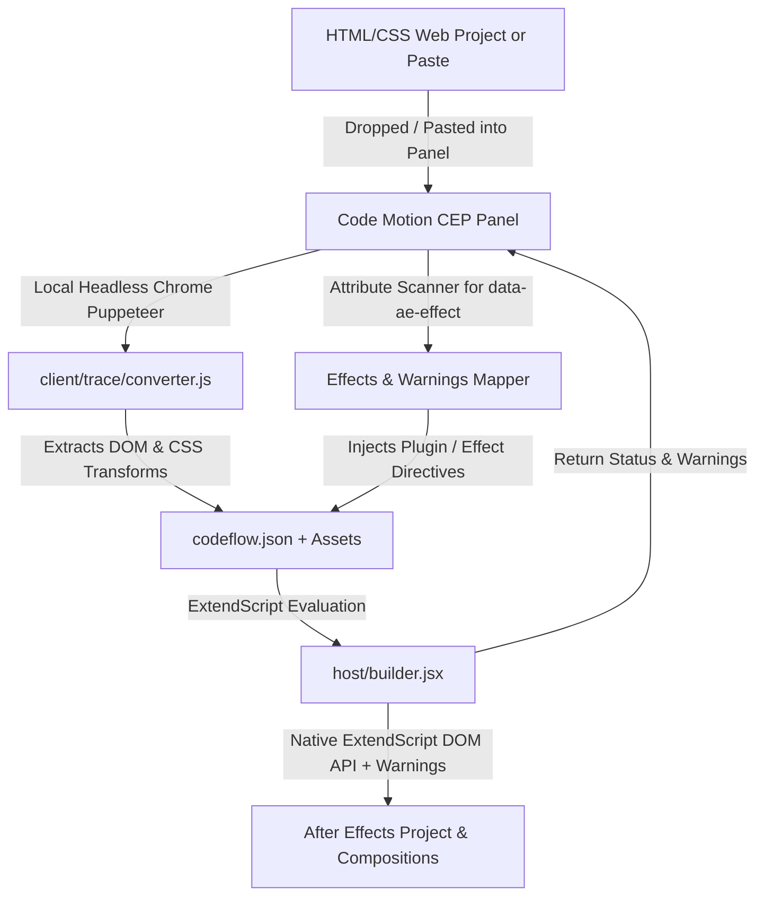

# Code Motion - Project Context & Architecture

> [!IMPORTANT]
> **Environment & Machine Notice**:  
> Recent development was conducted on the **father's laptop** (`d:\Code\OCTOBER 2026\14 Code flow extention`).  
> When switching back to the primary workstation or another machine, transfer the entire `14 Code flow extention` folder (or sync `CodeMotion/`, `.agents/`, and `checkpoints/`) to ensure all features, checkpoints, and skills remain identical.

## 1. Project Overview
**Code Motion** (by Revived Naim) is an independent Adobe After Effects (CEP) extension that converts web animations (HTML, SVG DOM hierarchies, Canvas, CSS keyframes, and web fonts) into native, editable After Effects compositions with full keyframe animations, shape layers, editable typography, and asset hierarchies.

---

## 2. System Architecture

### Key Components
1. **CEP Panel (`client/index.html`, `client/main.js`, `client/css/style.css`):**
   - Native Adobe After Effects panel running in Chromium Embedded Framework (CEF).
   - Styled with low-contrast, distraction-free **AE Monochrome** design system (`design.md`) with 0px sharp rectangular corners.
   - Linked via Windows Directory Junction: `%APPDATA%\Adobe\CEP\extensions\CodeMotion` → `d:/Code/OCTOBER 2026/14 Code flow extention/CodeMotion`.
   - Supports `F5` / `Ctrl + R` hot reload for instant feedback during pairing.
   - Global clipboard paste (`Ctrl + V`) listener and dedicated in-panel code drawer.
   - Real-time warning console displaying amber `⚠️` badges for missing 3rd-party plugins or unsupported effect fallbacks.
2. **Headless Chrome DOM Tracer (`client/trace/converter.js`):**
   - Unlocked, zero-dependency local tracer communicating via Chrome DevTools Protocol (CDP).
   - Samples live DOM transforms, 3D matrices, SVG paths, fonts, and images into `codeflow.json` in virtual time (~5–10 seconds).
3. **ExtendScript Builder Engine (`host/builder.jsx`):**
   - Pure, uncompiled ExtendScript (ES3 compatible) that translates `codeflow.json` into native After Effects elements.
   - Implements native `CodeMotionBuilder` with backward-compatible aliases.
   - Full support for native Gaussian Blurs, linear & radial ramps, vector dashes, and 3rd-party plugins with automatic fallbacks.
4. **Agent Skills:**
   - **`code-motion` (`.agents/skills/code-motion/`):** Unified master AI skill supporting both **Mode A** (Animated HTML motion graphics with `window.seek`, 3D rigs, and easing math) and **Mode B** (Pure static HTML/CSS layouts with 0 keyframes for manual AE animation), backed by the comprehensive master reference [convert.md](file:///d:/Code/OCTOBER%202026/14%20Code%20flow%20extention/.agents/skills/code-motion/references/convert.md).

---

## 3. Engineering Milestones & Solved Challenges

### A. Automatic Layer Parenting & Hierarchy Harmonization (Drift Fix)
* **The Root Cause**: When an HTML badge/chip container scales up, nested child elements (circle backgrounds, SVG icons, text labels) appear to move in screen-space. The tracer recorded these expansions as independent moving Position keyframes + duplicate Scale keyframes, causing elements in AE to drift apart, overshoot, and desynchronize.
* **The Solution**: In `builder.jsx`, `harmonizeCompLayers()` automatically identifies container shape layers and parents nested child layers directly to the container in After Effects (`childLayer.parent = parentLayer`).
* **Clean Transform Offsets**: Removes phantom position keyframes and redundant scale keyframes from child layers, locking them to pristine, static local resting offsets. Badges and chips now scale up as solid, unified rigid bodies with zero drifting.

### B. Typography & Text Formatting
* **Color Extraction**: Hex strings in `layer.text.fill` mapped to AE normalized RGB.
* **Safe Font Fallbacks**: Tries PostScript name first, then space-separated font family, with isolated try-catches around `sourceTextProp.setValue()` and integer tracking rounding to prevent parameter validation errors.
* **UTF-8 Encoding**: Explicit `jsonFile.encoding = 'UTF-8'` in ExtendScript ensures special punctuation and accented characters render correctly.

### C. Motion Smoothness & Keyframe Easing Math
* **2-Parameter Interpolation**: `setInterpolationTypeAtKey(keyIndex, inType, outType)` with incoming ease derived from `prevKey.e` and outgoing ease from `currKey.e`.
* **Bézier Temporal Easing**: Converts incoming handle influence (`1 - x2`) and outgoing influence (`x1`) to native After Effects `KeyframeEase`.
* **Spatial Tangent Zeroing**: Explicitly zeroes spatial tangents (`[0, 0, 0]`) on spatial properties to prevent AE's auto-Bézier spatial overshoot/wobble.

### D. 3D Space, Camera & Collapse Transformations
* **Selective Collapse**: Precomps only set `collapseTransformation = true` when specified in JSON (e.g. `div clip`). `#scene (3D scene)` does NOT collapse, preserving its internal native 3D camera.
* **Native AE 3D Cameras**: Camera zoom and perspective origin automatically derived from the CSS perspective property.
* **Language-Independent Match Names**: Uses `ADBE Rotate X/Y/Z` and `ADBE Position` to ensure compatibility across all language versions of After Effects.

### E. Vector Shapes & Native 2-Color Gradients
* **Bézier Paths**: Full support for `kind === 'path'` with `Shape()` vertices, inTangents, outTangents, and closed state.
* **Compound SVG Paths**: Handles multi-subpath arrays inside a single shape group for complex icons.
* **Native Gradients**: 2-color linear gradients map to native `ADBE Ramp` effects, keeping backgrounds vector-editable.
* **Drop Shadows**: Box shadows map to native `ADBE Drop Shadow` effects.

### F. Radial Gradients, Blur/Glow Layers & Vector Dashes
* **Radial Ramp Gradients**: Extended `ADBE Ramp` handling in `builder.jsx` with Property 5 (`Ramp Shape`): sets `2` for Radial, `1` for Linear. Fixes radial stage backgrounds and circular vignettes that previously fell back to linear.
* **Native Gaussian Blur Support**: Added native `ADBE Gaussian Blur 2` (with fallback to `ADBE Gaussian Blur`) for `type: "blur"` and `type: "gaussianBlur"`. Resolves previously skipped or blank shadow and glow layers.
* **Dashed Vector Strokes & Caps**: Added native `ADBE Vector Dashes` (`Dash` and `Gap`), `Line Cap` (`round`, `butt`, `projecting`), and `Line Join` (`miter`, `round`, `bevel`).

### G. 3rd-Party Plugin Pipeline & Graceful Fallbacks (e.g. Deep Glow)
* **HTML Directives**: Elements can declare `data-ae-effect="Deep Glow"` or `data-plugin="..."`.
* **Graceful Fallbacks**: If the user has Deep Glow (or another requested plugin) installed, After Effects applies it directly. If missing, ExtendScript catches the exception, applies a smooth 40px native Gaussian Blur fallback, and logs an actionable warning.
* **Console Warnings Pipeline**: `builder.jsx` collects skipped effects and plugin fallback notices into a `warnings` array returned via `SUCCESS:...||WARNINGS:...`. `main.js` unpacks them and logs amber `⚠️` messages directly in the CEP console.

### H. Safety Checkpoint Architecture
* Full pre-effects backup preserved at `checkpoints/checkpoint_20261019_pre_effects/` for rollbacks.

---

## 4. Test Suites (`tests/`)

Every test is a self-contained folder inside [`tests/`](file:///d:/Codes/00%20Playground/14%20Code%20flow%20extention/tests/) keeping its HTML, assets, and conversion bundle together:

| Path inside `tests/` | Contents | Key Features Tested |
| :--- | :--- | :--- |
| **`tests/flowly-saas/`** | `test.html`, `test (CodeFlow)/` | Staggered rising bar charts, background rings, revenue labels, "+24%" badge. |
| **`tests/custom-test/`** | `index.html`, `index (CodeFlow)/` | 3D scene rigs, rotating cards, satellite "Protected" badge, EMV chip SVG paths. |
| **`tests/orbit-cards/`** | `Orbit Cards.html`, `assets/`, `Orbit Cards (CodeFlow)/` | 3D rotating cards with local texture assets. |
| **`tests/spatial-player/`** | `index.html`, `index (CodeFlow)/` | Glassmorphic media HUD, waveform bars, audio badges. |
| **`tests/spatial-audio-hud/`** | `index.html`, `index (CodeFlow)/` | Futuristic vector overlays, circular gauges, nested badges. |
| **`tests/engine-test/`** | `index.html`, `index (CodeFlow)/` | Minimal reference test: 3D camera, 2-color ramp gradient, auto-parented badge. |
| **`tests/static-card/`** | `index.html` | Pure static HTML/CSS to AE (0 keyframes, live editable text, rounded shape pill). |

---

## 5. Development & Testing Workflow

1. Edit `MotionFlow/host/builder.jsx`, `MotionFlow/client/main.js`, or `MotionFlow/client/css/style.css`.
2. In After Effects, click the **Code Motion** panel tab.
3. Press **`F5`** (or **`Ctrl + R`**) to reload the panel.
4. Drag and drop any test folder or HTML file onto the panel.
5. Click **Build in AE** to generate compositions.
6. Verify timeline playback and layer hierarchy in After Effects.
